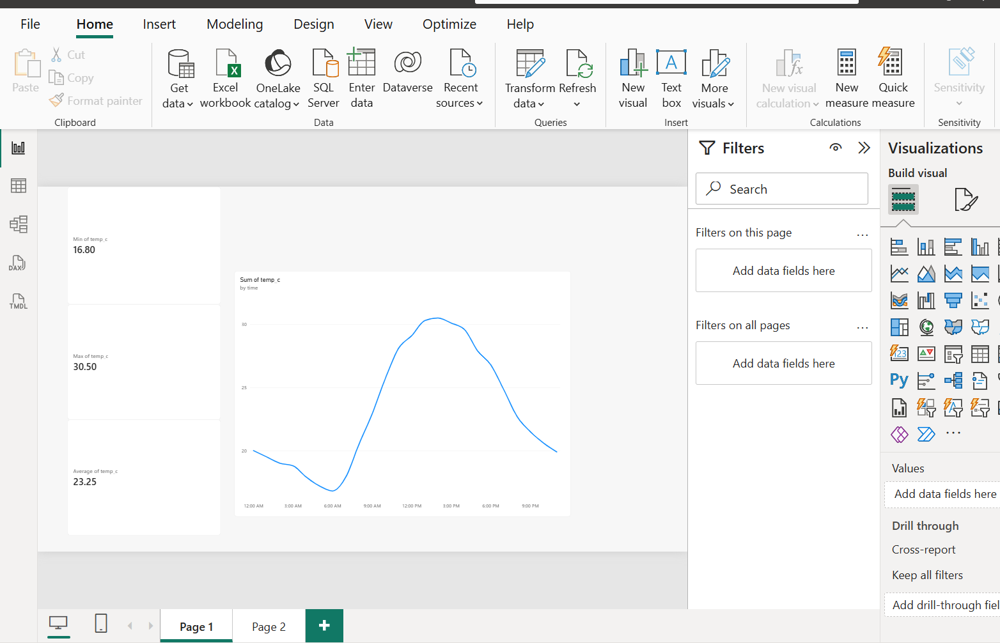
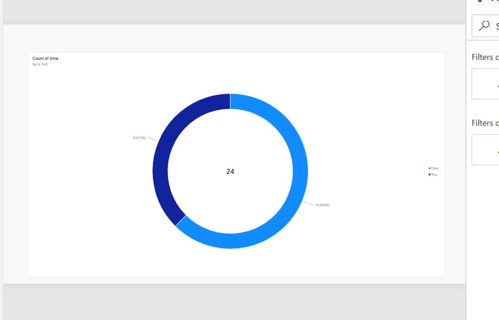

# airflow-weather-etl

A beginner-friendly learning project using Apache Airflow DAGs to orchestrate an ETL pipeline that extracts, transforms, and loads weather data into a Postgres database, with a Power BI dashboard on top.

## Architecture

```
Open-Meteo API  -->  Apache Airflow  -->  PostgreSQL  -->  Power BI
   (source)        (extract, transform,     (storage)      (dashboard)
                    load, report)
```

Everything except Power BI runs in Docker containers.

## What it does

Every day, Airflow runs a pipeline of five tasks:

```
extract  >>  transform  >>  load_to_db  >>  report  >>  done
```

| Task | Operator | What it does |
|------|----------|--------------|
| `extract` | PythonOperator | Downloads hourly temperatures from the free [Open-Meteo](https://open-meteo.com/) API and saves the raw JSON |
| `transform` | PythonOperator | Cleans the data, skips missing values, and adds an `is_hot` flag (above 25 °C) |
| `load_to_db` | PythonOperator | Saves the rows into the `weather_hourly` table in Postgres (upsert, so re-runs never create duplicates) |
| `report` | PythonOperator | Queries the table and prints the row count and min, max, and average temperature to the task log |
| `done` | BashOperator | Prints a finish message |

The location is set by the latitude and longitude in the `URL` constant in `dags/weather_pipeline_dag.py`. Change them to use any city.

## Screenshots

### Airflow


### Power BI dashboard




## Tech stack

- Apache Airflow 2.10.5
- Python 3 (`requests`, `psycopg2`)
- PostgreSQL 13
- Docker and Docker Compose
- Power BI Desktop (Windows)
- Open-Meteo API (no API key needed)

## Project structure

```
airflow-weather-etl/
├── dags/
│   └── weather_pipeline_dag.py        # the DAG
├── docker-compose.yaml                # official Airflow setup
├── docker-compose.override.yaml       # adds the weather-db Postgres container
├── requirements.txt
├── .gitignore
├── Graph.png, Gridview.png, ...       # screenshots
└── README.md
```

Docker Compose loads `docker-compose.override.yaml` automatically and merges it with `docker-compose.yaml`, so the official Airflow file stays untouched.

## Database

The `weather-db` container creates a database named `weather` on first start. The `load_to_db` task creates this table automatically:

| Column | Type | Description |
|--------|------|-------------|
| `time` | TIMESTAMP (primary key) | The hour the temperature is for |
| `temp_c` | DOUBLE PRECISION | Temperature in °C |
| `is_hot` | BOOLEAN | True if above 25 °C |
| `loaded_at` | TIMESTAMP | When the row was saved |

These credentials are for local learning only. Never use passwords like these in a real project.

## How to run it

Airflow does not run natively on Windows, so this project uses Docker.

1. Install and open [Docker Desktop](https://www.docker.com/products/docker-desktop/). Wait until it says "Engine running".
2. Clone this repo and move into the project folder:
   ```bash
   git clone https://github.com/<your-username>/<repo-name>.git
   cd <repo-name>/airflow-weather-etl
   ```
3. Create the folders and settings file Airflow needs.

   **Windows (PowerShell):**
   ```powershell
   mkdir logs, plugins, config
   "AIRFLOW_UID=50000" | Out-File -Encoding ascii .env
   ```
   **Linux / macOS:**
   ```bash
   mkdir -p logs plugins config
   echo "AIRFLOW_UID=$(id -u)" > .env
   ```
4. Initialize Airflow (first time only):
   ```bash
   docker compose up airflow-init
   ```
5. Start Airflow and the weather database:
   ```bash
   docker compose up -d
   ```
6. Open http://localhost:8080 and log in with `airflow` / `airflow`.
7. Find `weather_pipeline`, switch it on, and click the play button to trigger it. Wait until all tasks are green.

To stop everything, run `docker compose down`. Your data is kept in a Docker volume. Do not use `docker compose down -v`, because the `-v` deletes the volume and your data with it.

## Viewing the output

**Task logs:** in the Grid view, click a task and open the **Logs** tab. The `report` task shows the temperature summary.

**Database:** query the table from the terminal:
```bash
docker compose exec weather-db psql -U weather -d weather -c "SELECT * FROM weather_hourly LIMIT 5;"
```

**Power BI dashboard:**

1. Open Power BI Desktop and choose **Get data**, then **PostgreSQL database**.
2. Enter these details:
   - Server: `127.0.0.1:5433`
   - Database: `weather`
   - Data Connectivity mode: Import
3. On the credentials screen, choose the **Database** tab and enter username `weather` and password `weather`.
4. If it warns about encryption, click **OK**. This is a local connection.
5. Select `weather_hourly` and click **Load**.
6. Build the visuals:
   - **Line chart:** `time` on the X-axis, `temp_c` on the Y-axis
   - **Cards:** `temp_c` set to Minimum, Maximum, and Average
   - **Donut chart:** `is_hot` as the legend, count of `time` as the value

After each new pipeline run, click **Refresh** in Power BI to load the latest rows. Docker must be running for the refresh to work.

## Troubleshooting

- **Power BI says "unreachable network":** use `127.0.0.1:5433` instead of `localhost:5433`. Windows can resolve `localhost` to IPv6, which Docker's port does not listen on.
- **`time` splits into Year, Quarter, Month, and Day:** turn off **Auto date/time** in Power BI under File, Options, Current File, Data Load.
- **`relation "weather_hourly" does not exist`:** the table is created by the `load_to_db` task, so trigger the DAG once first.
- **Docker command fails with "cannot find the file specified":** Docker Desktop is not running. Open it and wait for "Engine running".

## What I learned

- How a DAG is built from DAG arguments, the DAG definition, task definitions, and the task pipeline (`>>`)
- How to use `PythonOperator` and `BashOperator`
- How to schedule, retry, and monitor tasks in the Airflow UI (Graph view, Grid view, logs)
- How to run Airflow and Postgres together with Docker Compose, using an override file
- How to load data into Postgres with an upsert so re-runs are safe
- How to connect Power BI to a database and build a simple dashboard

