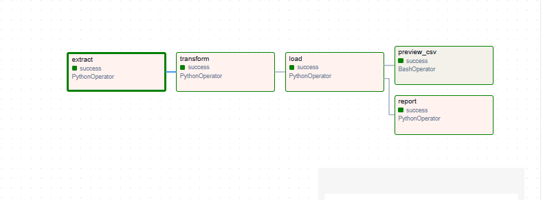
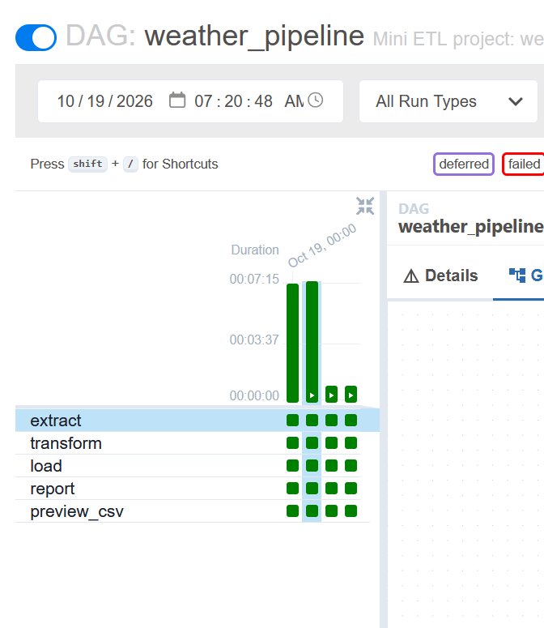
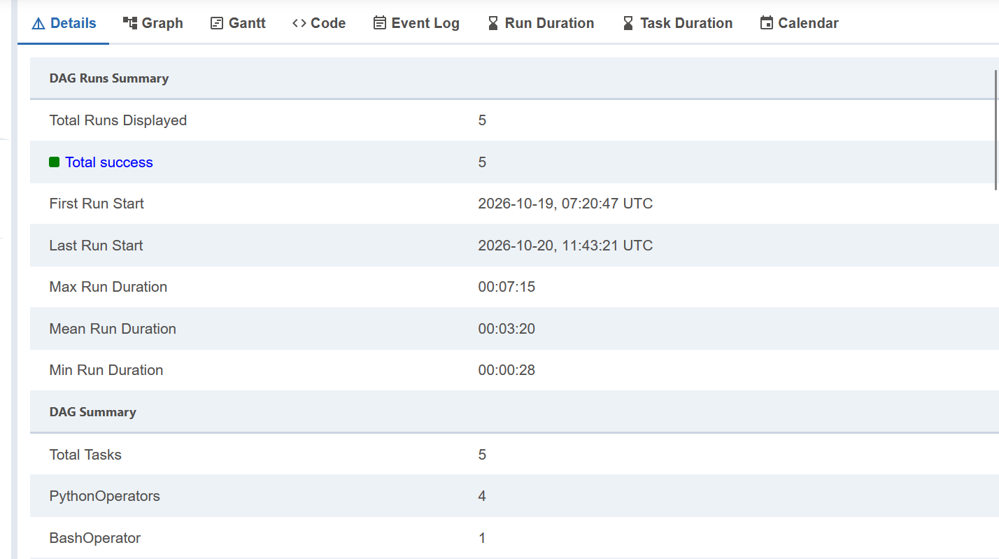

# airflow-weather-etl

A beginner-friendly learning project using Apache Airflow DAGs to orchestrate a simple ETL pipeline that extracts, transforms, and loads weather data.

## What it does

Every day, Airflow runs a pipeline of five tasks:

```
extract  >>  transform  >>  load  >>  report
                                  >>  preview_csv
```

| Task | Operator | What it does |
|------|----------|--------------|
| `extract` | PythonOperator | Downloads hourly temperatures from the free [Open-Meteo](https://open-meteo.com/) API and saves the raw JSON |
| `transform` | PythonOperator | Cleans the data, skips missing values, and adds an `is_hot` flag (above 25 °C) |
| `load` | PythonOperator | Writes the clean rows to `weather.csv` |
| `report` | PythonOperator | Prints the min, max, and average temperature to the task log |
| `preview_csv` | BashOperator | Prints the first lines of the CSV |

`report` and `preview_csv` run in parallel because neither depends on the other.

## Screenshots

Add your own screenshots to a `screenshots/` folder and link them here:





## Tech stack

- Apache Airflow 2.10.5
- Python 3
- Docker and Docker Compose
- Open-Meteo API (no API key needed)

## Project structure

```
airflow-weather-etl/
├── dags/
│   └── weather_pipeline_dag.py   # the DAG
├── docker-compose.yaml           # Airflow setup
├── requirements.txt
├── .gitignore
└── README.md
```

## How to run it

Airflow does not run natively on Windows, so this project uses Docker.

1. Install and open [Docker Desktop](https://www.docker.com/products/docker-desktop/). Wait until it says "Engine running".
2. Clone this repo and move into it:
   ```bash
   git clone https://github.com/<your-username>/airflow-weather-etl.git
   cd airflow-weather-etl
   ```
3. Create the folders and settings file Airflow needs.

   **Windows (PowerShell):**
   ```powershell
   mkdir logs, plugins, config
   "AIRFLOW_UID=50000" | Out-File -Encoding ascii .env
   ```
   **Linux / macOS:**
   ```bash
   mkdir -p logs plugins config
   echo "AIRFLOW_UID=$(id -u)" > .env
   ```
4. Initialize Airflow (first time only):
   ```bash
   docker compose up airflow-init
   ```
5. Start Airflow:
   ```bash
   docker compose up
   ```
6. Open http://localhost:8080 and log in with `airflow` / `airflow`.
7. Find `weather_pipeline`, switch it on, and click the play button to trigger it.

To stop Airflow, press `Ctrl + C`, then run `docker compose down`.

## Viewing the output

- **Task logs:** in the Grid view, click a task and open the **Logs** tab. The `report` task shows the temperature summary.
- **CSV file:** the file is created inside the container. Copy it to your computer with:
  ```bash
  docker compose cp airflow-worker:/tmp/weather_pipeline/weather.csv ./weather.csv
  ```

## What I learned

- How a DAG is built from DAG arguments, the DAG definition, task definitions, and the task pipeline (`>>`)
- How to use `PythonOperator` and `BashOperator`
- How to schedule, retry, and monitor tasks in the Airflow UI (Graph view, Grid view, logs)
- How to run Airflow with Docker

## Ideas for improvement

- Save the data to a database (SQLite or Postgres) instead of a CSV
- Add a dashboard with Power BI or Streamlit
- Send an alert when the temperature is above a limit
- Add more cities
